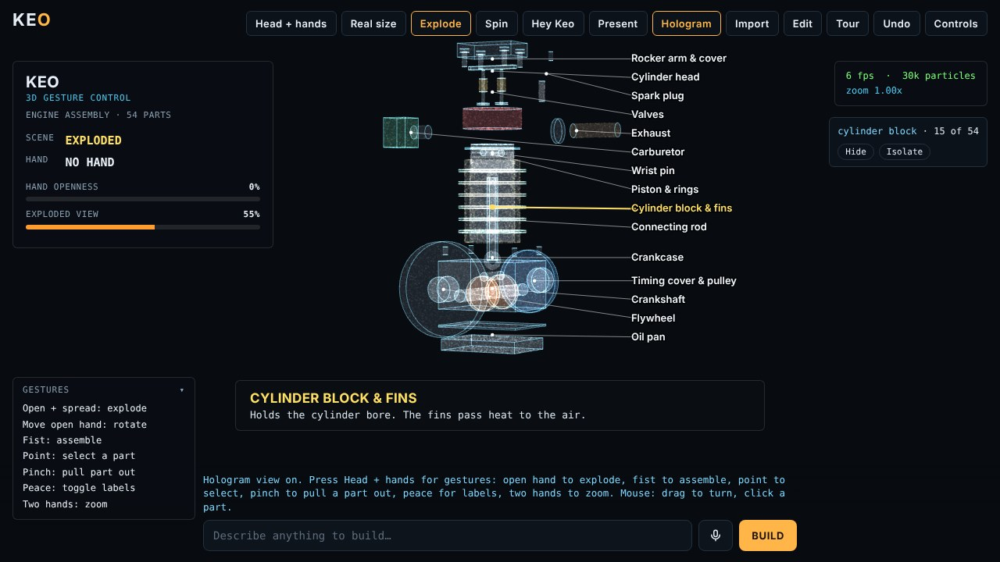

# KEO

A browser prototype that shows a 3D model at real size, in front of you, and lets you handle it with the mouse, your hands or your voice. No install and no build step: open `index.html` in Chrome.

*Screenshot shows the hologram view with the camera background hidden. Hand and webcam behaviour has been tested with simulated landmarks only, not on real hardware.*

## What it does

- **Head-tracked "window" view.** The screen acts as a window into a small room. The camera uses an off-axis projection that follows your head (webcam face tracking) or your mouse, so the object appears to sit behind the glass.
- **Real size.** Calibrate with a bank card or enter your screen width, and 1 mm in the model is 1 mm on the screen. Parts too large for the screen are drawn to scale beside a person, hand or door.
- **Free rotation.** A quaternion trackball with no tilt limit, so you can turn the model upside down and see the underside. The model floats at its own centre, with an optional "on the floor" mode.
- **Assemblies.** A 54-part single-cylinder engine loads from a built-in library of 16 designs. Explode it with a button, a slider or a command, click any part to name it, then hide or isolate it.
- **Voice and hands.** Press **Keo voice**, then say "Keo" followed by a command, for example "Keo, run airflow" ("Hey Keo" works too; the wake word matches common mishearings), or hold Space to talk. Make a fist in front of the camera to turn the model. Pinch and move your hand up or down to zoom, or hold both open hands up and move them apart or together. Commands such as "make it 150 wide", "explode" and "show it from below" are understood.
- **Build new parts.** Describe a part and Claude returns a validated spec of primitives (box, cylinder, cone, sphere, torus, extrusion, lathe) that is built in the scene. Without a Claude connection, the offline library and a local command parser still work.
- **Import real files and edit them.** Press **Import** (or drop a file anywhere on the page). Supported: `.stl`, `.step`/`.stp`, `.iges`/`.igs`, `.brep`, and `.zip` files (KEO unzips them in the browser and imports the best CAD file inside: STEP first, then IGES, STL, BREP). SolidWorks (`.sldprt`, `.sldasm`) and other native CAD files are not open formats and cannot be read here: in the CAD program use File > Save As and choose STEP or STL, then import that. STEP files keep each solid as its own part, with its colour and name; an STL that contains several separate pieces is split into parts automatically. Press **Edit** to open the part editor: click a part, then change its name, position, rotation, size and colour, duplicate it, hide it or delete it. Add boxes, cylinders, spheres, cones and torii next to the model, split a single imported shape into pieces, or fix the units (STL files carry none, so they are read as mm; buttons scale inches or cm to mm). Every edit can be undone with **Undo**, and **Export STL** writes the edited result. Imported parts also work with Explode, Isolate, labels and the Hologram view. Edits move and resize whole parts; they do not cut holes or change the inner shape of a mesh.
- **Very large STEP files (25 MB and up).** Opening a 142 MB, 468-solid VTOL assembly in one go needs several GB, which a browser tab cannot give. KEO instead reads the file's structure (a few seconds), cuts it into small per-solid STEP pieces and converts them in parallel in up to 4 background workers, so memory stays low and the page stays usable. It handles both flat files (all solids in one product, common for NX) and real assemblies: it reads the assembly tree and part transforms itself, converts each unique part once and places every instance. Checks: placements of every instance matched OpenCascade's own full read on two test assemblies (3 and 1163 instances, within 0.5 mm); the 142 MB VTOL converted in about 217 s on a 2-core sandbox with 3 workers (about 511 s with one worker), 468 solids, about 750k triangles, colours kept. Mesh detail is set from the whole model's size, so small parts stay light. KEO never refuses a file for being big. If the splitter cannot read a file's structure (for example it builds assemblies with mapped items), KEO says why, with the solid and link counts it found, and then falls back to the whole-file method at any size. That method can take many minutes and may run out of memory on very large files; if it does, `tools/keo_convert.py` (`pip install cadquery numpy`, then `python tools/keo_convert.py FILE.stp`) writes a small `.keomesh` file that opens in about 2 s. A progress line starting "Big STEP file" means the piece-by-piece path is running; a line starting "KEO can't split this STEP file" means it has fallen back.
- **Convert once, automatically.** When a STEP, IGES or BREP file takes more than a few seconds to convert (or is a big STEP file), KEO keeps the converted model in this browser's own storage (IndexedDB, newest 6 files, nothing is uploaded anywhere). Opening the same file again, identified by name, size and date, loads the saved copy in about 2 s instead of converting again. The Edit panel's **Save .keomesh** button (or typing "save the converted copy") downloads that copy as a small `.keomesh` file; drop it onto KEO on any device and it opens without conversion, and no Python is needed. Type "forget saved" to remove every saved copy. Tested here: a 1,163-part STEP converted in 6 s, reopened from the saved copy in 1 s with identical triangle and part counts, and the downloaded `.keomesh` matches the format `tools/keo_convert.py` writes. Limits: browsers can clear site storage, private windows may not keep it, and a copy over 250 MB is not stored; a file with solids that failed to convert is not saved.
- **Find models online.** Type or say "find jet engine assemblies on GrabCAD" (also works for Thingiverse, Printables, TraceParts and Sketchfab). KEO opens that site's search for you in a new tab. It cannot download from GrabCAD by itself: GrabCAD requires you to be logged in to download, and has no public API, so KEO does not scrape or automate it. Download the model yourself (a `.zip` is fine) and drop it on KEO, which imports the STEP or STL inside.
- **Airflow (CFD).** Press **Airflow** (or say "run airflow", "wind tunnel", "stop airflow"). KEO turns the visible model into solid cells and runs a 3D lattice-Boltzmann (D3Q19) wind tunnel in a background thread, with air blowing left to right. Streaks are coloured by speed (blue slow or in the wake, green free stream, red fast). Rotate the model and it re-runs once you stop. Controls sets the airflow speed (Reynolds number, 30-400) and detail (Low 64x32x32, Medium 96x48x48, High 128x64x64 cells). Important limits: it is a low-resolution, low-Reynolds-number visualisation, not engineering CFD. The drag index is computed by momentum exchange and reads high: on a test sphere it gave 1.40-1.45 at Re 100 and about 1.08 at Re 200, against about 1.09 and 0.80 from the standard Schiller-Naumann correlation (about 30% too high; the error stays when the grid is refined from 16 to 22 cells across, so it comes mostly from the small, open domain and the staircase surface). Use it to compare shapes, not to predict real drag. No turbulence model, no walls friction model beyond bounce-back, no heat or compressibility.
- **Hologram colours.** In Controls choose Spectrum (each assembly group gets its own hue), Neon, Ember, Aurora, Cyan or Original (the model's own colours), or say "make the hologram ember".
- **Export.** The current model, with your edits, is saved as a binary STL in millimetres.
- **Output modes.** Present (full screen for a projector), Pyramid (under Controls: four views for a Pepper's ghost pyramid), red-cyan anaglyph 3D, and side-by-side stereo for a 3D TV or projector.
- **Hologram view (main demo).** Your webcam becomes a grayscale background and the model is drawn in front of it as a glowing particle hologram (about 30,000 points sampled from the surface, plus faint edges), with part labels and leader lines, a hand skeleton, and a status panel (Controls, or press `C`). With **Head + hands** on, seven gestures control it (the gesture list is a card in the bottom-left corner; click its title to fold it): open hand and spread the fingers to explode, move the open hand to rotate, fist to assemble, point to select a part (its name and description appear), pinch to pull the selected part out, peace sign to toggle labels (or press `L`), and two hands apart or together to zoom. The mouse works too: drag to turn, click a part. The default look is a clean hologram (translucent glass-like surfaces with glowing edges and outlines). Controls has a Particles look with adjustable density (Light, Normal, Dense) if you prefer the glowing-dots style. The model is drawn in front of the video and does not hide behind you.
- **Inspect view.** The default room view with head-tracked "window" projection, real-size mode and the other output modes.
- **Tour.** A 30-second guided demo (press Tour).

## Run it

1. Download this folder and open `index.html` in Chrome or Edge.
2. Move the mouse. Press **Tour** to see everything.
3. Hands and voice need a camera, a microphone, and Chrome. Chrome's speech recognition uses Google's service, so it needs an internet connection.
4. To build free-form parts offline, paste a Claude API key into **Controls**. It is stored only in your browser. Usage is billed to your own account, so set a spend limit.

Keyboard: `E` explode, `S` spin, `F` flip over, `R` reset view, `P` present, `3` cycle 3D output, `C` hologram view, `L` labels (hologram view), `Esc` deselect, `Space` push-to-talk.

## How it is built

- Single HTML file with no bundler. three.js r128 is included in the file, so the viewer works offline.
- `updateCamera` and `eyeCamera` set a per-frame asymmetric frustum from the tracked head position and the physical screen size, which is what makes the view look like a window.
- Parts are generated from a JSON spec in millimetres, and a sanitiser limits part counts, sizes and polygon points before anything is built.
- Hand tracking and face detection use MediaPipe Tasks Vision. Anaglyph output renders each eye to a render target and merges them in a small shader.
- Checked with headless Chromium (Playwright) tests of the tour, part picking, export, both 3D modes, Pyramid and Present, and the voice wake-word logic, using mocked speech input.

## Limits

- Camera hand tracking, the microphone and physical projection have not been tested on real projector or pyramid hardware. Treat them as working prototypes.
- Parts built by Claude are approximations made from simple shapes, not production CAD.
- Head tracking follows one person. In stereo modes, other viewers see a slightly skewed image.
- STEP import depends on a CDN-loaded library, so it needs internet the first time.
- This is a prototype, not a product. Similar viewing hardware and AI CAD assistants already exist; this project explores combining real-size viewing, voice and assembly handling in a lightweight browser app.

## Licence

MIT. See `LICENSE` for third-party notices.

## Windows app

`KEO-Windows.zip` holds a packaged desktop app (Electron, unsigned): unzip, run `KEO.exe`. It requests the high-performance GPU and shows the GPU in use in the Hologram view. STEP/IGES/BREP import works offline there. Voice is not available in the app (Electron has no speech service); use `KEO-Chrome.bat` for voice. Built and tested on Linux with a virtual display; not yet run on Windows hardware.
